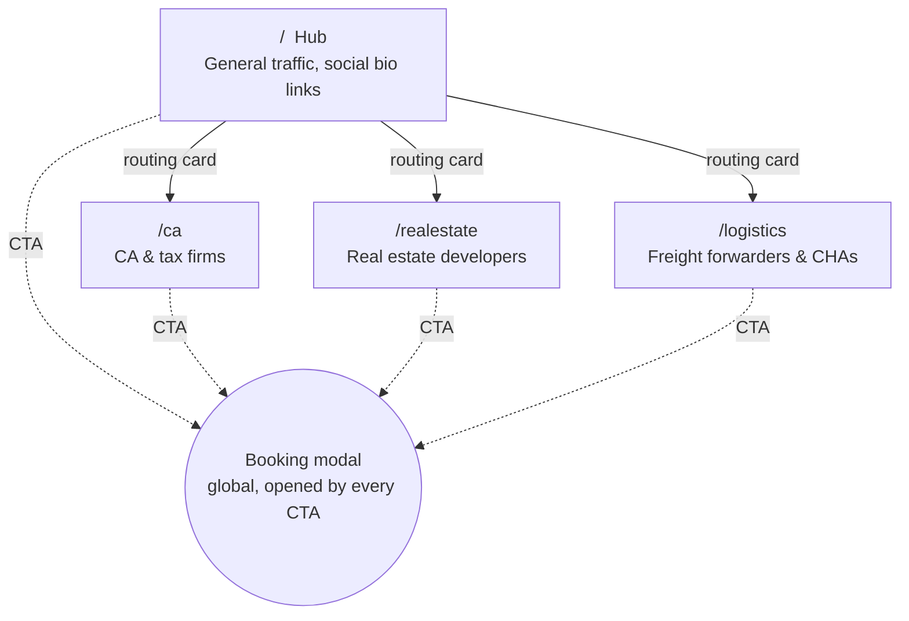
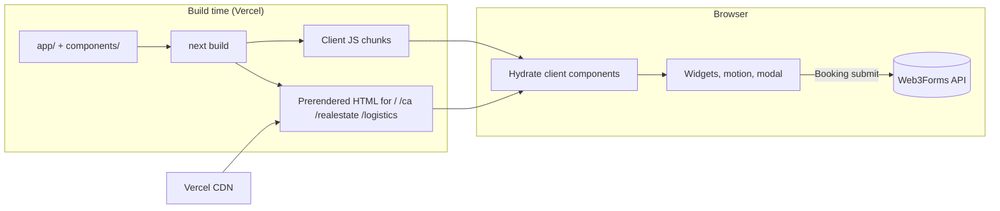
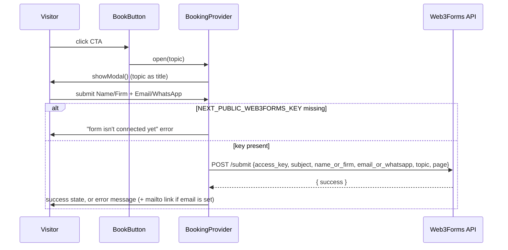
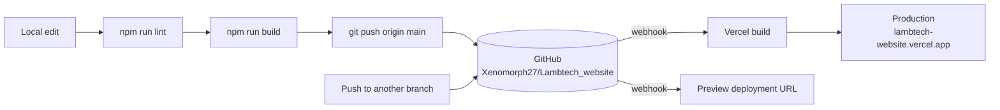

# LambTech Website — Architecture

How the LambTech marketing site is built, how its pieces fit together, and where to change things.

| | |
|---|---|
| **Live site** | https://lambtech-website.vercel.app |
| **Repository** | https://github.com/Xenomorph27/Lambtech_website (branch `main`) |
| **Hosting** | Vercel project `lambtech-website`, auto-deploys on every push to `main` |
| **Stack** | Next.js 16.4 (App Router, Turbopack) · React 19.3 · TypeScript · Tailwind CSS 4.3 |
| **Source of requirements** | *LambTech Master Operating Plan & Website Architecture Blueprint* (summarised in `docs/design-spec.md`) |

---

## Contents

1. [Purpose and positioning](#1-purpose-and-positioning)
2. [Site map](#2-site-map)
3. [Technology stack](#3-technology-stack)
4. [Folder structure](#4-folder-structure)
5. [Rendering and request flow](#5-rendering-and-request-flow)
6. [Root layout and shared shell](#6-root-layout-and-shared-shell)
7. [Page anatomy](#7-page-anatomy)
8. [Component reference](#8-component-reference)
9. [Interactive widgets](#9-interactive-widgets)
10. [Data and content model](#10-data-and-content-model)
11. [Lead capture (booking modal)](#11-lead-capture-booking-modal)
12. [Design system](#12-design-system)
13. [Motion and interaction](#13-motion-and-interaction)
14. [Navigation and scroll behaviour](#14-navigation-and-scroll-behaviour)
15. [Accessibility](#15-accessibility)
16. [SEO and metadata](#16-seo-and-metadata)
17. [Build, quality checks and deployment](#17-build-quality-checks-and-deployment)
18. [Configuration and environment](#18-configuration-and-environment)
19. [How to make common changes](#19-how-to-make-common-changes)
20. [Known gaps and open items](#20-known-gaps-and-open-items)

---

## 1. Purpose and positioning

LambTech is positioned as a **productized operational engineering studio**: custom, human-in-the-loop automation pipelines built on a client's existing ERP, Tally or spreadsheets, delivered in **14 days** with **no per-seat SaaS fees**.

The site's job is to:

- route each visitor to the vertical that matches their business,
- prove the offer with **interactive demos running on sample data**, and
- convert through a single **2-field booking form** (Name/Firm + Email/WhatsApp) reachable from every call-to-action.

Following the blueprint's *"one parent domain, four dedicated routes"* model, each vertical page contains only content relevant to that audience.

---

## 2. Site map



The header nav and footer link all four routes from every page.

| Route | Audience | Headline | Signature widget | Primary CTA |
|---|---|---|---|---|
| `/` | Multi-vertical visitors | "We Eliminate Operational Debt for High-Volume Businesses." | Hero pipeline preview, operational-debt calculator, 14-day timeline | Book a 15-min audit |
| `/ca` | Managing partners / tax heads, 10–50 staff CA practices | "Stop Losing 200+ Hours a Month to GSTR-2B Matching." | Batch reconciliation simulator (500 → 452 / 34 / 14) | Send Us 5 Sample Invoices for a Free Prototype |
| `/realestate` | Ops heads / compliance at developers (Sec. 194-IA) | "Automate Property TDS (Form 26QB / 141) Splits." | 1% TDS split calculator + Form 16B queue | Get a Custom Walkthrough for Your Project |
| `/logistics` | Ops managers at forwarders and CHAs | "Catch Bill of Lading Errors Before Customs Holds Your Cargo." | Traffic-light 3-way audit with ISO 6346 check | Test Our Parser on 5 Sample BoLs |

All four routes are **statically prerendered** at build time. There are no API routes and no server-side data fetching.

---

## 3. Technology stack

| Layer | Choice | Notes |
|---|---|---|
| Framework | **Next.js 16.4.6** (App Router) | `cacheComponents` and `partialPrefetching` enabled in `next.config.ts`. This version has breaking changes from older Next.js; see `AGENTS.md` and `node_modules/next/dist/docs/`. |
| Bundler | Turbopack | CSS goes through `@tailwindcss/turbopack`. |
| UI | React 19.3 | Server Components by default; interactive pieces are `"use client"`. |
| Language | TypeScript 5 | Path alias `@/*` → project root. |
| Styling | Tailwind CSS 4.3 + `app/globals.css` | Theme tokens in `@theme inline`; bespoke animations as plain CSS classes. |
| Animation libraries | `motion` (Framer Motion successor), `gsap` | Dependencies of the vendored React Bits components. |
| Fonts | `next/font/google`: **Manrope** (text), **JetBrains Mono** (data) | Self-hosted at build time; exposed as `--font-manrope` / `--font-jetbrains`. |
| Forms | **Web3Forms** (hosted form endpoint) | Called directly from the browser; no backend. |
| Hosting | **Vercel** | Static output on the CDN; Git-connected. |
| Lint | ESLint 9 + `eslint-config-next` | `components/reactbits/**` excluded (vendored code). |

---

## 4. Folder structure

```
Lambtech_website/
├── app/                          Routes (Next.js App Router)
│   ├── layout.tsx                Root layout: fonts, metadata, global shell
│   ├── globals.css               Tailwind import, theme tokens, background, animations
│   ├── page.tsx                  /            Hub page
│   ├── ca/page.tsx               /ca          CA & tax content + BatchSimulator
│   ├── realestate/page.tsx       /realestate  Real estate content + TdsCalculator
│   └── logistics/page.tsx        /logistics   Logistics content + BolAudit
│
├── components/
│   ├── Nav.tsx                   Sticky grey header, desktop links + mobile menu
│   ├── Footer.tsx                Dark footer: verticals + contact
│   ├── Booking.tsx               BookingProvider (modal + context), useBooking, BookButton
│   ├── ScrollReset.tsx           Scroll-to-top on link navigation
│   ├── Sections.tsx              Shared sections: Eyebrow, ShinyBadge, StatsBand,
│   │                             ToolMarquee, Faq, CtaBand
│   ├── Vertical.tsx              VerticalPage template + DocCard (used by all 3 verticals)
│   ├── HeroPipeline.tsx          Hub hero: looping pipeline-run preview
│   ├── Timeline.tsx              Hub: interactive 14-day delivery timeline
│   ├── motion.tsx                BlurText, Reveal, HeroBackdrop
│   ├── widgets/
│   │   ├── BatchSimulator.tsx    /ca demo
│   │   ├── TdsCalculator.tsx     /realestate demo
│   │   ├── BolAudit.tsx          /logistics demo
│   │   └── RoiCalculator.tsx     Hub "operational debt" calculator
│   └── reactbits/                Vendored from reactbits.dev (TS + Tailwind variants)
│       ├── ClickSpark.tsx  CountUp.tsx  DotGrid.tsx  LogoLoop.tsx
│       └── Magnet.tsx  RotatingText.tsx  ShinyText.tsx  SpotlightCard.tsx
│
├── lib/
│   ├── site.ts                   Site settings (contact details, form key) + vertical list
│   └── checks.ts                 inr() formatter, ISO 6346 container check
│
├── public/logo.png               Logo (512×512), also the favicon
├── docs/design-spec.md           Condensed design brief from the master plan
├── architecture.md               This document
├── .env.example                  Template for NEXT_PUBLIC_WEB3FORMS_KEY
├── next.config.ts  tsconfig.json  eslint.config.mjs  package.json
└── AGENTS.md                     Next.js 16 notice for coding agents (auto-written by next dev)
```

Not committed (`.gitignore`): `node_modules`, `.next`, `.env*` (except `.env.example`), `.vercel`, `.claude`, `.impeccable`.

---

## 5. Rendering and request flow



- **Server Components** (no client JS of their own): route pages (`app/**/page.tsx`), `Vertical.tsx`, `Footer.tsx`.
- **Client Components** (`"use client"`): `Nav`, `Booking`, `ScrollReset`, `Sections`, `HeroPipeline`, `Timeline`, `motion.tsx`, all `widgets/*`, all `reactbits/*`.
- Route-to-route navigation is client-side (Next `<Link>`); only changed segments are fetched.
- The only network call at runtime is the booking form POST to `https://api.web3forms.com/submit`.

---

## 6. Root layout and shared shell

`app/layout.tsx` wraps every page in the same shell:

```
<html lang="en" data-scroll-behavior="smooth" class="font variables">
  <body>
    <ScrollReset />                    route-change scroll handling
    <BookingProvider>                  context + the single <dialog>
      <ClickSpark>                     site-wide click sparks (React Bits)
        <Nav />                        sticky header
        <main>{page}</main>
        <Footer />
      </ClickSpark>
    </BookingProvider>
  </body>
</html>
```

| Element | Responsibility |
|---|---|
| `ScrollReset` | Scrolls to top after link navigation (see §14). |
| `BookingProvider` | Owns modal state and exposes `open(topic)` to any descendant via context. |
| `ClickSpark` | Draws a short indigo spark burst on every click anywhere on the page. |
| `Nav` | Logo, Home / CA & Tax / Real Estate / Logistics, "Book a call", hamburger menu below `md`. |
| `Footer` | Dark slate band: tagline, vertical links, contact details from `lib/site.ts`. |

---

## 7. Page anatomy

### 7.1 Hub (`app/page.tsx`)

| # | Section | Contents | Key components |
|---|---|---|---|
| 1 | **Hero** | Shiny badge, blur-in headline, rotating "No more …" phrase, intro with red/green highlights, CTAs, three green ticks; right side shows a looping pipeline run | `ShinyBadge`, `BlurText`, `RotatingText`, `BookButton`, `HeroPipeline`, `HeroBackdrop` |
| 2 | **Tool marquee** | Draggable strip: Tally Prime, Excel, Google Sheets, Zoho Books, SAP, GST Portal, TRACES, Gmail, Outlook, WhatsApp, Custom ERP | `ToolMarquee` → `LogoLoop` |
| 3 | **Stats band** | 14 days · 95%+ accuracy · 90% cleared · ₹0 seat fees (count-up, green for wins) | `StatsBand` → `CountUp` |
| 4 | **Problem** | "You don't need another SaaS subscription." + 4 pain cards (red ✕) + green 90% callout | `Reveal` |
| 5 | **Routing cards** (`#verticals`) | One spotlight card per vertical with URL, blurb and stat | `SpotlightCard`, `Link` |
| 6 | **Operational debt calculator** | Sliders for people / hours / cost → hours and ₹ per month | `RoiCalculator` |
| 7 | **14-day guarantee** | Tabbed Sample Lock → Custom Build → Live Test → Handover with a 14-cell day bar | `Timeline` |
| 8 | **See it work first** | Discovery audit → Free prototype → Scope and lock | static |
| 9 | **What you own on day 14** | Six deliverable cards | `SpotlightCard` |
| 10 | **FAQ** | Five accordion questions | `Faq` |
| 11 | **Closing CTA** | Dark band over an interactive dot grid | `CtaBand` → `DotGrid` |

### 7.2 Vertical pages (`app/{ca,realestate,logistics}/page.tsx`)

The three vertical pages are **pure content files**. Each exports a `VerticalContent` object and one widget, and renders the shared template:

```tsx
export default function Page() {
  return <VerticalPage content={content} widget={<BatchSimulator />} />;
}
```

`VerticalPage` (`components/Vertical.tsx`) renders the same sequence for every vertical:

| # | Section | Driven by |
|---|---|---|
| 1 | **Hero**: badge, blur-in headline, intro, red **Today** / green **After** strip, CTA + "Try the live demo ↓" (`#demo`); right side shows a **DocCard** (sample document with scan line and check chips) | `eyebrow`, `headline`, `accent`, `sub`, `before`, `after`, `cta`, `doc` |
| 2 | **Stats band** (red = pain, green = win) | `stats` |
| 3 | **Live demo** (`#demo`): dark panel holding the widget | `widgetTitle`, `widgetSub`, `widget` prop |
| 4 | **How it runs**: 3 numbered steps with arrows | `flow` |
| 5 | **Built-in checks**: 4 spotlight cards | `checks` |
| 6 | **Manual vs. LambTech** table (red manual column, green LambTech column) | `comparison` |
| 7 | **FAQ** with "Ask us directly" button | `faq` |
| 8 | **Closing CTA** | `cta`, `closing` |

---

## 8. Component reference

### 8.1 Shell and shared

| Component | File | Type | Purpose / API |
|---|---|---|---|
| `Nav` | `Nav.tsx` | client | Sticky `#d1d5db` header. Active link shown as a dark pill (`usePathname`). Adds a shadow once scrolled. Mobile menu below `md`. |
| `Footer` | `Footer.tsx` | server | Renders only the contact entries that are filled in `lib/site.ts`. |
| `BookingProvider` / `useBooking` / `BookButton` | `Booking.tsx` | client | See §11. `BookButton` props: `topic`, `variant` (`primary` · `dark` · `light`), `magnetic` (defaults on except for `dark`), `className`. |
| `ScrollReset` | `ScrollReset.tsx` | client | See §14. |
| `Eyebrow` | `Sections.tsx` | client | Small mono uppercase label (`dark` prop for dark panels). |
| `ShinyBadge` | `Sections.tsx` | client | Pill with pulsing green dot and a shimmering label (`ShinyText`). |
| `StatsBand` | `Sections.tsx` | client | Dark band of `CountUp` numbers. Item: `{ to, prefix?, suffix?, label, tone?: "green" \| "red" }`. |
| `ToolMarquee` | `Sections.tsx` | client | `LogoLoop` of tool pills. |
| `Faq` | `Sections.tsx` | client | Accordion of `{ q, a }[]`; first item open by default. |
| `CtaBand` | `Sections.tsx` | client | Closing dark band over a `DotGrid`; props `title`, `body`, `topic`, `button`. |
| `VerticalPage`, `DocCard` | `Vertical.tsx` | server | Vertical template (§7.2) and sample-document card. |
| `HeroPipeline` | `HeroPipeline.tsx` | client | Cycles CA → Real Estate → Logistics runs every 4.2 s; clicking a tab pins it. |
| `Timeline` | `Timeline.tsx` | client | Tabs (click or hover) plus a 14-day bar highlighting the active phase. |
| `BlurText` | `motion.tsx` | client | Headline that blurs in word by word; `accent` words are indigo. |
| `Reveal` | `motion.tsx` | client | Fade/slide-up on scroll via IntersectionObserver (`delay` in ms). |
| `HeroBackdrop` | `motion.tsx` | client | Cursor-reactive `DotGrid` behind heroes, masked by `.hero-fade`. |

### 8.2 Vendored React Bits (`components/reactbits/`)

Installed from the reactbits.dev registry (`https://reactbits.dev/r/<Name>-TS-TW.json`) and kept as published, except where noted.

| Component | Used for | Where |
|---|---|---|
| `DotGrid` | WebGL dot field that reacts to cursor and clicks | Hero backdrops, closing CTA |
| `RotatingText` | Cycling "No more …" phrase | Hub hero. **Local patch:** only shuffles when `staggerFrom="random"`, because `Math.random()` during render breaks static prerendering. |
| `ClickSpark` | Spark burst on click | Whole site (root layout) |
| `Magnet` | Buttons lean toward the cursor | `BookButton` (primary / light variants) |
| `SpotlightCard` | Glow following the cursor | Routing, deliverable and check cards |
| `CountUp` | Numbers counting up on scroll | `StatsBand` |
| `LogoLoop` | Infinite, draggable strip | `ToolMarquee` |
| `ShinyText` | Moving shine across text | `ShinyBadge` |

---

## 9. Interactive widgets

All widgets are client components using **deterministic sample data** from the master plan. Nothing is sent anywhere.

### 9.1 `BatchSimulator` — `/ca`

- Builds a fixed batch of **500 purchase invoices** at module load: index rules mark **34 value mismatches** and **14 missing in Tally**, leaving **452 exact matches**. Rows 0 / 3 / 7 carry the plan's examples (Apex Logistics ₹1,00,000 match; Zenith Supplies ₹48,000 vs ₹50,000; Metro Corp ₹25,000 missing).
- **Run batch** animates 0 → 500 over 3.6 s (`requestAnimationFrame`) with a live log of the last six rows and three bucket counters.
- When finished it shows "% Tally-ready" and a tabbed exception table (mismatch / missing).
- Reduced motion: jumps straight to the result.

### 9.2 `TdsCalculator` — `/realestate`

- Fixed context: Unit Tower B-402, consideration ₹85,00,000, buyers Rahul Sharma (ABCDE1234F) and Priya Sharma (FGHIJ5678K).
- Inputs: **installment amount** (Indian digit grouping as you type) and **ownership split** slider (5% steps).
- Logic: `totalTds = round(amount × 1%)`; buyer A = `round(totalTds × share%)`; buyer B gets the remainder, so the two always add up exactly.
- Output: two Form 26QB challan cards and a Form 16B queue (`Unit-B402_<Name>_Form16B.pdf`). A buyer at 0% is dimmed and dropped from the queue.

### 9.3 `BolAudit` — `/logistics`

- Fixed BoL: 420 cartons, 24,500 kg, master `MSCU9876543`.
- Editable: **packing-list carton count** and **container ID**; buttons load "With discrepancy" (400 cartons) or "Clean shipment".
- Checks: carton count must equal 420; container ID must pass **ISO 6346** (`lib/checks.ts`).
- Verdict panel: **Red alert · hold** (lists each failure, ERP sync blocked) or **Green · cleared to sync**.
- Note: the plan's example ID `MSCU-883920-1` fails the real check digit (should be 3), so the demo uses `MSCU-883920-3`.

### 9.4 `RoiCalculator` — hub

- Sliders: people (1–40), hours per week (2–40), monthly cost per person (₹15k–₹1L).
- `monthlyHours = people × hours × 4.33`; hourly cost = salary ÷ (4.33 × 45 h); value recovered = 90% of both.
- Labelled on the page as an illustrative estimate, with a CTA to have the numbers audited.

### 9.5 `lib/checks.ts`

| Function | Behaviour |
|---|---|
| `inr(n)` | Rounds and formats with Indian grouping (`1000000` → `10,00,000`). |
| `checkContainer(input)` | Normalises (strips spaces and dashes), requires 4 letters + 7 digits, computes the ISO 6346 check digit (letter values skip multiples of 11; weights 2^i; `sum % 11 % 10`). Returns `{ wellFormed, valid, expected }`. |

---

## 10. Data and content model

There is **no CMS or database**. Content lives in typed TypeScript objects:

| What | Where |
|---|---|
| Brand name, location, email, X handle, LinkedIn, WhatsApp, form key | `lib/site.ts` → `site` |
| Vertical list (route, label, title, blurb, stat) used by Nav, Footer and hub cards | `lib/site.ts` → `verticals` |
| Hub copy (debts, steps, deliverables, FAQ, stats) | Constants at the top of `app/page.tsx` |
| Each vertical's copy | `content: VerticalContent` in `app/<vertical>/page.tsx` |
| Widget sample data | Inside each widget file |

`VerticalContent` shape (`components/Vertical.tsx`):

```ts
{
  eyebrow, headline, accent: string[], sub,
  before, after,                       // red "Today" / green "After" lines
  cta,                                 // also used as modal title and closing headline
  doc: { name, rows: { label, value, flag? }[], chips: { text, ok }[] },
  stats: { to, prefix?, suffix?, label, tone? }[],
  widgetTitle, widgetSub,
  flow: { title, body }[],             // 3 steps
  checks: { title, body }[],           // 4 cards
  comparison: { metric, manual, automated }[],
  faq: { q, a }[],
  closing,
}
```

Adding a field to this type makes TypeScript require it on all three vertical pages, which keeps them consistent.

---

## 11. Lead capture (booking modal)



- One native `<dialog>` for the whole site (`Booking.tsx`). It closes on ✕, Escape or a backdrop click.
- The **topic** is the button's own label (for example "Test Our Parser on 5 Sample BoLs"), so each lead arrives tagged with where it came from. The page path is sent too.
- Validation: both fields required; contact needs at least 5 characters.
- The key is `NEXT_PUBLIC_*`, so it's embedded in client JS. That's normal for Web3Forms access keys, which are designed to be public.

---

## 12. Design system

### 12.1 Colour

| Token / value | Role |
|---|---|
| `#ffffff` | Base (~62% of the page background) |
| `--color-tone` **`#c3ccfb`** (periwinkle) | Second tone (~38%, right side) |
| `--rule` **`#050505`** | Thin black line on the colour boundary |
| `--rule-soft` **`#d1d5db`** | Thick light-grey band inside the white edge; also the nav bar colour |
| `#0f172a` / `slate-900` | Text, dark bands, footer, demo panels |
| `#6366f1` / `indigo-600` | Single brand accent: headline accents, primary buttons, links |
| Emerald (`emerald-50…800`) | **Wins**: ticks, "After", automated column, good stats |
| Rose (`rose-50…800`) | **Pain**: ✕ badges, "Today", manual column, bad stats |
| Amber | Exceptions in demos (mismatch, human review) |

### 12.2 Dual-tone page background

Defined once on `body` in `globals.css` as a fixed, 104° linear gradient:

```
white ─────────────── grey band (36px) ─ gap ─ black line (3px) ─ periwinkle ──────
0%                    62% − 50px        −14px  62% ± 1.5px        62%           100%
```

Because it's `background-attachment: fixed`, every section sits on the same split and the split stays put while scrolling. Sections are transparent unless they're deliberately dark bands or white cards. To change the proportion, edit `--edge`; to change band widths, edit the `calc()` offsets.

### 12.3 Typography

- **Manrope**: all text; headlines are extra-bold with tight tracking, using `text-balance`.
- **JetBrains Mono**: numbers, eyebrows, file names, logs and other data, using `tabular-nums`.

### 12.4 Utility classes (`globals.css`)

| Class | Effect |
|---|---|
| `.blur-word` | Per-word blur-in (used by `BlurText`) |
| `.reveal` / `.is-in` | Scroll reveal (used by `Reveal`) |
| `.hl-red`, `.hl-green` | Marker-style highlight that sweeps in |
| `.bg-grid`, `.bg-grid-dark` | 44px line grid texture |
| `.hero-fade` | Radial mask fading the dot grid at the edges |
| `.scan-line` | Indigo line sweeping down the DocCard |
| `.float-a`, `.float-b` | Gentle bob for floating hero chips |
| `.pop-in`, `.log-row` | Entry animations for list items |
| `.pulse-dot` | Pulsing status dot |
| `dialog.booking` | Modal entrance animation and blurred backdrop |

---

## 13. Motion and interaction

| Effect | Implementation | Trigger |
|---|---|---|
| Headline blur-in | CSS `.blur-word` | Page load |
| Section fade-up | `Reveal` + IntersectionObserver | Scroll into view |
| Interactive dot grid | React Bits `DotGrid` (WebGL) | Cursor proximity, click shock |
| Rotating phrase | React Bits `RotatingText` | Every 2.6 s |
| Count-up stats | React Bits `CountUp` | Scroll into view |
| Spotlight cards | React Bits `SpotlightCard` | Hover |
| Magnetic CTAs | React Bits `Magnet` | Cursor near button |
| Click sparks | React Bits `ClickSpark` | Any click |
| Tool strip | React Bits `LogoLoop` | Continuous; hover slows, drag scrubs |
| Shiny badge | React Bits `ShinyText` | Continuous |
| Pipeline preview | `HeroPipeline` interval + `.pop-in` | Every 4.2 s, or tab click |
| Document scan | `.scan-line` | Continuous |
| Highlight sweep | `.hl-red` / `.hl-green` | Page load |

**Reduced motion:** the `prefers-reduced-motion` media query disables the CSS animations and scan line, `BatchSimulator` and `HeroPipeline` skip their animation, and the React Bits components check the preference themselves.

---

## 14. Navigation and scroll behaviour

**Problem (fixed in `bd06d86`):** Next.js resets scroll on route change by calling `scrollIntoView` on each section of the new page. On this layout that left visitors near the bottom of the new page when they clicked a link from the top.

**Solution:**

1. Every internal `<Link>` passes `scroll={false}` (Nav ×3, Footer, hub routing cards), switching Next's handling off.
2. `ScrollReset` watches `usePathname()` and, in a layout effect, calls `window.scrollTo({ top: 0, behavior: "instant" })`.
3. It **skips**:
   - Back/Forward: detected by the Navigation API `navigate` event (`navigationType === "traverse"`), with a capturing `popstate` listener as fallback;
   - URLs with a `#hash`, so in-page anchors (`#verticals`, `#demo`) still work.
4. `html { scroll-behavior: smooth }` keeps anchor jumps smooth. `data-scroll-behavior="smooth"` on `<html>` is the Next.js 16 opt-in that keeps that from affecting route changes.

**Rule for new links:** any new internal `<Link>` must also pass `scroll={false}`, or it will bring the bug back.

---

## 15. Accessibility

- Semantic structure: one `<h1>` per page; sections use `<h2>`; tables use `scope` on headers.
- `BlurText` puts the full headline in `aria-label` and hides the per-word spans.
- The modal is a native `<dialog>` (focus trapping, Escape to close) with `aria-labelledby`.
- Tabs (`Timeline`, `HeroPipeline`, exception table) use `role="tablist"`, `tab`, `aria-selected`; the FAQ uses `aria-expanded` and `aria-controls`.
- Live results (`aria-live="polite"`) on the TDS calculator, BoL verdict and batch summary.
- Sliders expose `aria-valuetext`; the progress bar uses `role="progressbar"`.
- Decorative elements (dot grids, sparks, arrows, ✓/✕ glyphs) are `aria-hidden`.
- Visible `:focus-visible` outline in indigo; reduced-motion support as in §13.

---

## 16. SEO and metadata

- `metadataBase`: `https://www.lambtech.in`. Title template `%s · LambTech`; default title "LambTech — We eliminate operational debt".
- Each vertical page sets its own `title` and `description` (for example "GSTR-2B reconciliation automation for CA & tax firms").
- Favicon: `/logo.png`.
- Fully static HTML, so crawlers see all content without running JavaScript.
- Not yet present: `sitemap.ts`, `robots.ts`, Open Graph images, structured data.

---

## 17. Build, quality checks and deployment



| Command | Purpose |
|---|---|
| `npm run dev` | Dev server on http://localhost:3000 (Turbopack). If styles look stale after editing `globals.css`, hard-refresh. |
| `npm run lint` | ESLint (vendored React Bits excluded). |
| `npm run build` | Production build; also type-checks and prerenders all routes. |
| `npm start` | Serve the production build locally. |

**Deploys:** the Vercel project `lambtech-website` is linked to the GitHub repo with production branch `main`. Each push to `main` deploys to production; other branches get preview URLs.

---

## 18. Configuration and environment

| Setting | Where | Notes |
|---|---|---|
| `NEXT_PUBLIC_WEB3FORMS_KEY` | `.env.local` locally; **Vercel → Project → Settings → Environment Variables** in production | Needed for the booking form to send. Redeploy after adding. |
| Contact details | `lib/site.ts` | Empty fields are hidden from the footer and modal. |
| Next.js options | `next.config.ts` | `cacheComponents`, `partialPrefetching`, Turbopack Tailwind loader. |
| Lint scope | `eslint.config.mjs` | Ignores `.next`, `out`, `build`, `next-env.d.ts`, `components/reactbits/**`. |

---

## 19. How to make common changes

| Task | Where and how |
|---|---|
| Change copy on a vertical | Edit the `content` object in `app/<vertical>/page.tsx`. |
| Change hub copy or sections | `app/page.tsx` (constants at the top, sections in JSX). |
| Fill in contact details | `lib/site.ts` (`email`, `xHandle`, `linkedin`, `whatsapp`). |
| Connect the booking form | Create a Web3Forms access key → set `NEXT_PUBLIC_WEB3FORMS_KEY` in Vercel → redeploy. |
| Add a new vertical | 1) Add an entry to `verticals` in `lib/site.ts`. 2) Create `app/<slug>/page.tsx` exporting `metadata` and a `VerticalContent`. 3) Build a widget in `components/widgets/`. Nav, footer and hub cards pick it up automatically (the hub grid is 3 columns, so adjust it for a 4th card). |
| Change the background split or colours | `globals.css`: `--edge`, `--color-tone`, `--rule`, `--rule-soft`. |
| Change the accent colour | Indigo is used as Tailwind classes (`indigo-*`) across components; search and replace, and update `--color-accent`. |
| Add a stat in red/green | Set `tone: "red" \| "green"` on the stat item. |
| Add an internal link | Use `<Link href="…" scroll={false}>` (see §14). |
| Add another React Bits component | Fetch `https://reactbits.dev/r/<Name>-TS-TW.json`, save the file into `components/reactbits/`, install any listed dependencies, and check `npm run build` (watch for `Math.random()` during render). |

---

## 20. Known gaps and open items

| Item | Status |
|---|---|
| Booking form | Shows "not connected" until `NEXT_PUBLIC_WEB3FORMS_KEY` is set in Vercel. |
| Contact details | Blank in `lib/site.ts`; footer shows only "Mumbai, India". |
| Custom domain | `lambtech.in` still points at the previous site; not attached to the Vercel project. |
| Back-button scroll | Back/Forward keeps the current scroll position rather than restoring the earlier page's position. |
| SEO extras | No sitemap, robots file, Open Graph image or structured data yet. |
| Copy review | FAQ answers, deliverables, "Today/After" lines and calculator assumptions were written from the master plan and need a business review. |
| `README.md` | Still the default create-next-app README. |
| Tests | No automated tests; the widget logic (`lib/checks.ts`, TDS split, batch counts) is a good first candidate. |
